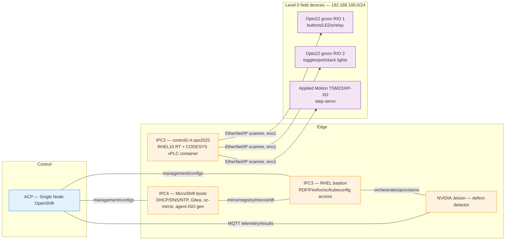

# CLAUDE.md

This file provides guidance to Claude Code (claude.ai/code) when working with code in this repository.

## What this repo is

Setup/automation for a physical Red Hat edge-manufacturing demo stand (SPS 2025, Munich/Singapore lab): bootc Containerfiles for the edge hosts, Kubernetes/Kustomize manifests deployed via GitOps, Ansible playbooks, and the CODESYS PLC project that drives the physical stand. It is infrastructure-as-code for a lab, not an application with its own build/test suite — there is no app-level lint/test command; "correctness" here means "does the manifest/Containerfile/playbook do what the docs say," checked by reading the YAML/Containerfiles and cross-referencing the markdown docs below, not by running a test runner.

**Read these first, in this order, before making non-trivial changes:**
- [README.md](README.md) — setup steps, per-device/per-workload instructions, access info
- [HOW_IT_WORKS.md](HOW_IT_WORKS.md) — IPC4 image → MicroShift → Gitea/GitOps → ACP end-to-end flow
- [SNO-GitOps-Workflow.md](SNO-GitOps-Workflow.md) — ArgoCD Application / umbrella-chart mechanics on ACP
- [Troubleshoot-July2026.md](Troubleshoot-July2026.md) — incident history/root causes (IPC4/IPC3/ACP)
- [workloads/Codesys/CODESYS-Workflow.md](workloads/Codesys/CODESYS-Workflow.md) — the PLC logic itself (Purdue L0/L1)

## Physical / logical topology



- **IPC4** runs MicroShift from a bootc image built out of `images/ipc4/`; it provides DHCP/DNS/NTP for the `192.168.100.0/24` lab network, hosts Gitea (the GitOps source of truth) and a local `oc-mirror` registry, and generates/serves the agent ISO used to install ACP.
- **ACP** (Single Node OpenShift) is installed from that agent ISO and bootstraps ArgoCD, pointed at Gitea, which deploys the demo's OpenShift-hosted workloads (MQTT broker, Windows VMs via OpenShift Virtualization, simulated OPC-UA/defect services, GEC Oncite, MES, etc.).
- **IPC2** (`control2-rt.sps2025`) is a RHEL10 realtime bootc host running the CODESYS Virtual Control SL soft-PLC as a Podman container — the actual Level-1 controller for the physical stand.
- **IPC3** is the RHEL bastion used to drive/administer everything above (RDP, browser, `oc`/kubeconfig access, Ansible control node for `automate-cycle/`).
- **Jetson** runs the camera-based defect-detector inference app, talking MQTT to both the PLC and ACP-side services.

## Repository layout

```
images/            bootc Containerfiles + MicroShift manifests, one subdir per host image
  ipc1/              shared RHEL10-realtime bootc base (tag ipc-rh10-rt) + a Xentara variant
  ipc2/              CODESYS/CodeMeter layer on top of ipc1's base → IPC2's image
  ipc3/              (empty — IPC3 is a manually-installed RHEL9 bastion, no image built)
  ipc4/              MicroShift bootc image: Containerfile + per-component manifests
                      (dhcp/, dns/, ntp/, gitea/, gitea-operator/, oc-mirror/, ocp-agent-install/)
  ntp/, run-oc-mirror/  supporting images used by ipc4's manifests
playbooks/         Ansible playbooks for appliance/agent-ISO generation (ACP installer side)
execution-environment/  Containerfile + requirements for an Ansible execution environment
automate-cycle/    Ansible playbooks + systemd timers that power ACP on/off on a schedule (run from IPC3)
scripts/           scripts/create-iso.sh — bakes a bootc image + kickstart into a bootable ISO
kickstarts/        example kickstart file consumed by create-iso.sh
workloads/         everything deployed on top of IPC4/ACP, or run on Jetson/IPC2 — one subdir per workload
physical-layout/   wiring diagrams and electrical drawings for the physical stand (PDF/PNG)
```

### `workloads/` — one subdirectory per workload

| Path | What it is |
|---|---|
| `Codesys/` | The CODESYS project (`.projectarchive`/`.project`/`.xml`, via Git LFS) deployed to IPC2's vPLC, plus [CODESYS-Workflow.md](workloads/Codesys/CODESYS-Workflow.md) documenting the PLC logic and deployment process |
| `gitea/` | Screenshots documenting the Gitea→ArgoCD GitOps wiring (manifests live in `images/ipc4/gitea*`) |
| `mqtt-broker/` | Mosquitto broker manifests, deployed to ACP via ArgoCD |
| `defect-rec-sim/` | Simulated defect-recognition app (random output on an MQTT topic), runs on ACP |
| `defect-detector-jetson/` | YOLO model weights (`models/best-hat.pt` etc., via LFS) and annotated training images for the real camera-based detector that runs on the Jetson (app code lives in the separate `edge-defect-detector` GitHub repo, linked from README) |
| `csr-approver/` | CronJob + RBAC that auto-approves kubelet CSRs |
| `GEC/HelmCharts/`, `GEC/VM/` | German Edge Cloud Oncite: Helm charts, image-mirroring scripts/systemd units, ImageDigest/TagMirrorSet mappings |
| `ETH-IP-IO-Module/`, `ETH-IP-StepServoDrive/` | Manuals/EDS files/discovery tools for the Opto22 groov RIO I/O modules and the Applied Motion step-servo — the Level 0 field devices |
| `SwitchingNetworking/` | Datasheets for the network switches used on the stand |
| `WIN11-VM/`, `FTView-VM/` | OpenShift Virtualization manifests / exported VM image for the Windows VMs hosting CODESYS IDE and FactoryTalk View |
| `xentara/` | Containerfiles, RPMs, and config (`model.json`, `licence.json`) for a Xentara-based IPC image variant (in progress — see git status) |

## How the pieces fit together (GitOps flow)

1. `podman build images/ipc4/ --tag localhost/ipc4:latest --build-arg-file=build-args.txt` builds the MicroShift bootc image; `scripts/create-iso.sh` turns it + a kickstart into a bootable ISO for IPC4.
2. On boot, MicroShift applies everything under `/etc/microshift/manifests.d/<component>` (copied in from `images/ipc4/<component>/` at build time): DHCP/DNS/NTP, Gitea (+ operator), the `oc-mirror` job, and `ocp-agent-install`.
3. Gitea registers `acp-standard-services-public` (GitHub) as an **hourly pull mirror** with `enable_prune = false` — any local-only branch (e.g. `ipc4-local`, used for lab-specific chart customizations not meant for upstream) survives the sync; anything pushed to `dev`/`main` directly does not.
4. `ocp-agent-install`'s one-shot bootstrap Job creates exactly **one** ArgoCD `Application` (`acp-standard-services`) on ACP once, at install time. Its Helm chart is an app-of-apps: each `values.<key>` (`localStorage`, `virtualization`, `itAutomation`, `pipelines`, `networkInterfaceManagement`) gates whether a corresponding **child** Application gets rendered.
5. Chart **templates** are git-tracked and auto-sync normally. The parent Application's own `spec.source.helm.values` is **not** git-tracked — it only lives live on the cluster and baked into this repo's `images/ipc4/ocp-agent-install/configmap.yaml`. **Changing which services are enabled requires updating both** (live `oc patch` for immediate effect, the repo/IPC4 manifest for the next reinstall) — see [SNO-GitOps-Workflow.md](SNO-GitOps-Workflow.md) for the full mechanics and why this matters.

## Known gotchas worth knowing before touching related files

- **`automate-cycle/sno_on.service` / `sno_off.service` reference `/home/admin/Scripts/...` on IPC3, not this repo's `automate-cycle/` path** — the deployed units and the repo have drifted; update one or the other if you touch the power-cycle automation.
- **`images/ipc4/setup-storage.sh`** was patched (see [Troubleshoot-July2026.md](Troubleshoot-July2026.md)) to stop destructively re-wiping `microshift-storage` on every boot — the fix only takes effect on IPC4's *next* image rebuild, not the live host.
- **Defect-detector model swap** (`workloads/defect-detector-jetson/models/`) is a bind-mount, not baked into the image — replacing the `.pt` file and restarting the container/Quadlet is enough, no rebuild needed.
- Large binaries (`*.projectarchive`, `*.exe`, `*.img.gz`, `*.pt`, `*.jpg`) are tracked via **Git LFS** (`.gitattributes`) — make sure `git lfs` is set up before touching those files.
